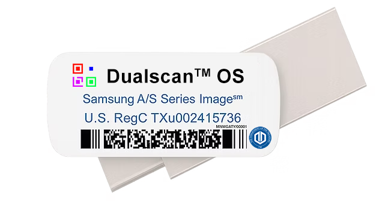

# Dualscan™ OS

**Your ecosystem. Anywhere.** A Samsung Smart Switch USB-C distribution from **Dualscan LLC**, with wallets, Typelocker tools, Diamond Player, a separate OEM app collection, and **191 artwork files**.



## Restore from USB-C

1. On this repository, choose **Code → Download ZIP**. GitHub creates the archive; the restore folder is committed directly, not supplied as a prebuilt ZIP.
2. Extract the complete downloaded repository on your computer and run the integrity verifier below. Open the extracted repository wrapper to find the supplied folders.
3. Copy **only the intact `SmartSwitchBackup2` restore folder** out of the extracted repository wrapper to the **root of a USB-C drive**. Do not rename it, change its contents, or nest it inside `dualscan-os-main`. The separate OEM apps, art collection and video are companion materials, not folders to insert into this backup.
4. Connect the USB drive to a compatible Samsung Galaxy device. Open **Settings → Accounts and backup → Smart Switch**, then its external-storage / SD-card control.
5. Under **Restore from**, choose **USB storage**, select the supplied backup and available categories, and tap **Restore**. Keep the drive connected until completion.
6. Return to the home screen, open the restored apps, and complete any account, storage or biometric setup they request on the receiving device.

```text
USB-C drive/
└── SmartSwitchBackup2/
    └── [original device and backup folders, unchanged]
```

The receiving-device path is Samsung Smart Switch on **compatible Galaxy devices**. This is an application/settings restore distribution; it does not flash a replacement Android firmware image. Diamond’s exact USB bit-perfect path requires **Android 14/API 34 or later**, a compatible audio HAL and USB DAC, and a supported source format. Android 14 on an arbitrary device does not by itself establish either Smart Switch restore support or bit-perfect support.

See [RESTORE.md](RESTORE.md) and [Samsung’s external-storage instructions](https://www.samsung.com/sg/support/apps-services/how-to-use-the-smart-switch-app-to-transfer-data-between-galaxy-devices/).

The original demonstration video, standalone OEM apps and art collection are included alongside the restore folder in the repository. The [project page](https://dualscan.cloud/) also has a video player and a guided screenshot tour. It is published with GitHub Pages from `main` → `/docs`; the page is static HTML, CSS and JavaScript.

## Inside the OS

The page tour follows **Desktop → App library → USPS® Wallet → Biometric unlock → USPS Money → Retail Code → Scan & Pay → VisaUSD Gaming Credits → Community Manual → Wallpaper Library → Personalized desktop**. Select a step or use the previous/next controls; screenshots can be enlarged.

| App or feature | What it provides |
| --- | --- |
| USPS Money | Local wallet UI, PIN and optional Android biometric unlock, Retail Code, Typelocker scanning and background customization. |
| VisaUSD™ | Local wallet, fresh biometric confirmation before Pay → Send, Gaming Credits NFC tap transfer, and the built-in 59-page U.S. Gamer Community Manual. |
| USPS® Wallet | The separate wallet application shown in the supplied screenshots, with its own wallet overview and scan/receive/send UI. |
| USPS Banking | The separately identified banking launcher; its services and accounts retain their own requirements. |
| Typelocker | Gmail/Outlook entries and ecosystem code handling. **Cypher** is the recovery format; **Sypher** is the ordinary in-app URL format. |
| Dualscan™ Chat | The supplied Briar-based messaging application, with its separate GPL source and license requirements. |
| Dualscan LDAC Activator | A guide/settings shortcut for compatible Bluetooth audio; separate from Diamond’s USB DAC output. |
| Diamond™ Player | Offline playback of supported encrypted music, video and photos directly from selected phone or USB folders. |
| Dualscan Share Lite — separate APK | Standalone 1.1.1 is included in the OEM app folder for encrypted media/document exchange; it is not installed by this supplied Smart Switch backup. |
| Dualscan Art Collection | **191 supplied artwork files**, separate from the restore payload. Transfer desired images to the device, then use Gallery to set a compatible image as home or lock-screen wallpaper. |

Apple Music, Suno, Amazon Music, ChatGPT, Gemini, UNO, Samsung and other third-party applications shown in the reference setup retain their own licenses, accounts, subscriptions and terms.

### Diamond Player and USB audio

The standalone OEM folder now includes [Diamond Player 1.4.3](https://github.com/sacs2cd-web/dualscan-os/blob/main/USTFD%20USPS%20CRADA%20APPS%20Oct%202026/Diamond-Player-1.4.3.apk), with automatic Samsung DeX TV display mode and a manual display-mode control. The supplied replacement Smart Switch backup includes Diamond Player’s encrypted base APK; the standalone 1.4.3 APK remains available in the OEM folder. Its presence does not establish the restored version inside the encrypted backup.

The current standalone Diamond Player uses an independent native PCM engine. When a supported USB DAC is selected on Android 14+, it requests the exact PCM encoding, sample rate, channel mask and Android `BIT_PERFECT` mixer behavior. The app only shows the bit-perfect indicator while its route and format checks are active. Ordinary internal-device audio routes remain available.

The standalone offline player is separate from the earlier Tidal WebView/Decent experiment. The app’s route checks do not constitute an independent physical DAC digital-output measurement. See [Android’s preferred mixer specification](https://source.android.com/docs/core/audio/preferred-mixer-attr).

### Share Lite: private and commercial exchange

This Smart Switch backup omits Share Lite. Install the standalone `USTFD USPS CRADA APPS Oct 2026/Dualscan-Share-Lite-1.1.1.apk` separately after restoration if needed. Companion APK filenames and standalone versions do not establish the versions inside the encrypted Smart Switch payload.

Create encrypted `.diamond` files from accessible local music, video, photos and documents. Each original is preserved as a separate encrypted container, keeping the collection’s folder structure. Only encrypted files are copied to the destination; completed copies are read back and verified by size and SHA-256.

Use an optional password for private recipient access. Password-free mode supports offline interchange among compatible Dualscan apps through their shared application key; it is not user-exclusive access control. Supported media plays in Diamond without public loose-file extraction. Documents can be carried encrypted even when the player cannot render their format.

Personal collections, private handoffs, artwork, albums, educational material and authorized commercial content packages can be exchanged. Encryption does not itself grant content rights or implement payment, revocation or DRM enforcement.

**Upcoming OEM device:** integrated app and PWA sharing is planned for the forthcoming OEM device. The current **Lite** release excludes APK/application packages, installed-app inventories and private app data.

## Community and commercial redistribution

Dualscan LLC’s [Dualscan OS Community & Commercial License v1.0](LICENSE) grants worldwide, non-exclusive, royalty-free use, customization and distribution of the intellectual property within its licensed scope. Personal, educational, nonprofit and commercial editions are permitted. **No separate commercial license or royalty is required for compliant use.**

Redistributed derivatives must preserve the protected components, operational behavior and five designated dock positions in [CORE_OEM_COMPONENTS.md](CORE_OEM_COMPONENTS.md). Retain the copyright/license notices, identify the derivative and disclose modifications. Additional trademark permissions are separate. Third-party rights and open-source permissions are preserved under Section 8; see [THIRD_PARTY_NOTICES.md](THIRD_PARTY_NOTICES.md).

### Encryption when exporting a derivative

| Intended distribution | Smart Switch export choice |
| --- | --- |
| Public derivative | Disable Samsung Account encryption; choose **No encryption**. |
| Private handoff | Choose **Password** and share that password separately with intended recipients. |
| Private derivative for a particular Samsung Account | Use **Samsung Account encryption** only when restore is intended for that account. |

Menu labels vary by Smart Switch version. Select the option before creating the derivative backup. Changing a download’s name does not convert existing encryption.

## Distribution integrity

The Smart Switch restore folder is preserved **as supplied**. The companion OEM folder includes Diamond Player 1.4.3 and the supplied VisaUSD 1.0.12 update, replacing the previous standalone VisaUSD 1.0.8 build. The restore folder, companion OEM folder, art collection and original video are separate release materials:

| Release material | Files | Exact bytes | Use |
| --- | ---: | ---: | --- |
| `SmartSwitchBackup2/` | 268 | 3,023,487,498 | Copy intact to the USB-C drive root for Smart Switch restore. |
| `USTFD USPS CRADA APPS Oct 2026/` | 17 | 373,144,143 | Separate standalone APKs and supplied source backups. |
| `Dualscan Art Collection/` | 191 | 560,264,205 | Companion artwork files. |
| Original restoration demo video | 1 | 19,365,643 | Watch the supplied restoration instructions. |
| **Complete release** | **477** | **3,976,261,489** | Approximately **3.98 GB**, before GitHub archive overhead. |

[RELEASE_SHA256.json](RELEASE_SHA256.json) records the exact byte count and SHA-256 of every supplied release file. [BACKUP_SHA256.json](BACKUP_SHA256.json) retains the restore-folder and video inventory. From the extracted repository, run:

```sh
python3 verify-backup.py
```

To verify an extraction stored elsewhere:

```sh
python3 verify-backup.py --root "/path/to/dualscan-os-main"
```

The verifier uses `RELEASE_SHA256.json` when available, checking all three folders, the original video, file counts, total bytes and file hashes. It rejects missing, unexpected or changed payloads and unsafe paths. Older extractions with only `BACKUP_SHA256.json` retain the restore-folder and video verification workflow.

Large original files use Git LFS. This repository must include LFS objects in generated archives so **Code → Download ZIP** contains the actual files. For a Git checkout, install Git LFS and run `git lfs pull`. A download containing text LFS pointers fails the verifier with a file-specific recovery hint and is not a complete release.

The supplied Smart Switch restore timestamp is `1792495176448`; original encrypted metadata and category files are retained without conversion. The byte counts above describe the distributed files, not Smart Switch’s reported logical restore size. Companion OEM APKs are separate from this payload, and their standalone versions are not evidence of versions inside encrypted backup files. A receiving-device restore and physical USB DAC qualification have not been performed as part of this publication. See [manifests/reference-backup-audit.json](manifests/reference-backup-audit.json).

## Project files

- [LICENSE](LICENSE) — supplied community/commercial terms, Dualscan LLC.
- [CORE_OEM_COMPONENTS.md](CORE_OEM_COMPONENTS.md) — protected packages, services, settings contracts and dock positions.
- [THIRD_PARTY_NOTICES.md](THIRD_PARTY_NOTICES.md) and [legal/](legal/) — component-specific rights and retained notices.
- [RESTORE.md](RESTORE.md) — USB-C restore and derivative encryption guide.
- [docs/](docs/) — portable static project page and screenshot tour.
- [RELEASE_SHA256.json](RELEASE_SHA256.json), [BACKUP_SHA256.json](BACKUP_SHA256.json) and [verify-backup.py](verify-backup.py) — full-stack and restore integrity records.
- `SmartSwitchBackup2/` — intact source restore folder; no prebuilt restore ZIP.
- `USTFD USPS CRADA APPS Oct 2026/` — separate OEM APKs and supplied source backups.
- `Dualscan Art Collection/` — separate companion artwork.

Copyright © 2026 Dualscan LLC. All rights reserved, subject to the applicable component licenses.
